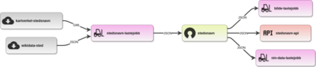

# stedsnavn-lastejobb

Lastejobb for å hente, transformere og publisere norske stedsnavn fra SSR (Sentralt stedsnavnregister). Resultatet brukes blant annet av [stedsnavn-api](https://github.com/Artsdatabanken/stedsnavn-api) og til fulltekstsøk.

Prosjektet er en trinnvis datarørledning bygget med Node.js og [`@artsdatabanken/lastejobb`](https://github.com/Artsdatabanken/lastejobb).

## Oversikt

Pipeline består i hovedsak av tre deler:

1. **Download** – laster ned rådata og støttefiler til `temp/`
2. **Transform** – reprojiserer, mapper, filtrerer og bygger sluttfiler i `build/`
3. **Deploy** – publiserer utvalgte filer til nedstrøms systemer

Viktige datakilder:
- Geonorge Stedsnavn i GML-format
- [`stedsnavn-ubehandlet`](https://github.com/Artsdatabanken/stedsnavn-ubehandlet) med supplerende mappinger
- Google Material Icons for ikonfiler

## Krav og forutsetninger

Før du kjører prosjektet lokalt bør du ha:

- **Node.js** og **npm**
- **Docker** eller tilsvarende oppsett som kreves av `@artsdatabanken/lastejobb` for GDAL-steg
- kommandolinjeverktøy som `unzip`, `sort`, `scp` og `ssh` der det er relevant
- nok diskplass og minne til å prosessere store filer

Merk:
- Sluttfilene er relativt små, men prosesseringen kan kreve rundt **5 GB diskplass**
- `transform` kjøres med stor Node-heap, som tyder på at jobben kan være minnekrevende
- På Windows kan filstier under `npm run download` bli for lange; bruk gjerne **WSL**

## Komponenter og dataflyt

### Dataflyt

[](https://artsdatabanken.github.io/stedsnavn-lastejobb/)

### Tegnforklaring

| Symbol                                                                                                   | Forklaring               |
| -------------------------------------------------------------------------------------------------------- | ------------------------ |
|   | API (HTTP REST)          |
|  | Åpne data                |
|  | Kart                     |
|  | Lastejobb / konvertering |
|   | Bibliotek                |
|  | Verktøy                  |
|   | Web-side/applikasjon     |

## Installasjon

Installer avhengigheter med:

```bash
npm install
```

## Bruk

### Last ned kildedata

```bash
npm run download
```

Kjører stegene i `stages/download/` og laster ned eksterne data og støttefiler til `temp/`.

### Transformer data

```bash
npm run transform
```

Kjører stegene i `stages/transform/` og produserer sluttfiler i `build/`.

Dette er kommandoen du typisk bruker under utvikling når du allerede har kjørt `download`.

### Kjør hele byggejobben

```bash
npm run build
```

Kjører først `download`, deretter `transform`.

### Bygg fulltekstindeks

```bash
npm run fulltext
```

Kommandoen finnes i `package.json`, men må verifiseres mot faktisk pipeline-oppsett dersom du skal bruke den aktivt.

### Deploy

```bash
npm run deploy
```

Kjører deploy-stegene. Dette krever normalt tilgang til eksterne miljøer og hemmeligheter som ikke er tilgjengelige lokalt for alle utviklere.

## Prosjektstruktur

### Viktige kataloger

- `stages/download/` – nedlasting av rådata og støttefiler
- `stages/transform/` – transformasjon, mapping og generering av sluttfiler
- `stages/deploy/` – deployskript
- `build/` – genererte artefakter
- `temp/` – midlertidige filer og mellomresultater
- `doc/` – dokumentasjon og produktspesifikasjon
- `.github/workflows/` – CI/CD-oppsett

### Viktige steg

#### Download
- `stedsnavn.js` – laster ned hoveddatasettet fra Geonorge
- `ubehandlet.js` – kloner `stedsnavn-ubehandlet`
- `material-icons.js` – kloner Material Icons

#### Transform
- `02_unzip.js` – pakker ut nedlastede filer
- `05_reproject.js` – reprojiserer data til EPSG:4326 med GDAL/ogr2ogr
- `10_inn_kategori.js` – bygger intern kategoristruktur fra kildeegenskaper
- `20_convert.js` – konverterer og filtrerer stedsnavn til mellomformat
- `25_steder_sort.sh` – sorterer output for stabile differ
- `30_koder.js` – bygger kodeverk og `steder_kategori.json`
- `40_alle.js` – leser XSD og bygger typehierarki
- `45_type.js` – skriver `build/type.json`
- `50_fulltextindex.js` – genererer fulltekstindeks i JSONL-format
- `60_ikon.js` – registrerer tilgjengelige ikonfiler
- `70_ikon.js` – kopierer og kobler ikoner mot kategorier

## Genererte filer

### `build/steder.csv`

Primær datasettfil med stedsnavn. Hver linje inneholder blant annet:
- stedsnummer
- prioritet/viktighet
- kategori-ID
- lengdegrad og breddegrad i EPSG:4326
- primærnavn

Eksempel:

| Prioritet | Kategori | Lengdegrad | Breddegrad | Navn             |
| --------- | -------- | ---------- | ---------- | ---------------- |
| E         | 11       | 17.3354    | 68.30591   | Storberget       |
| D         | 14       | 17.32879   | 68.3137    | Erikelva         |
| E         | 2        | 15.01159   | 68.83431   | Bakkejordstabben |

### `build/steder_kategori.json`

Oversetter numerisk kategori-ID til intern kode, for eksempel:

```json
{
  "items": [
    {
      "id": 29,
      "kode": "SN-S-F-F"
    },
    {
      "id": 251,
      "kode": "SN-S-F-H"
    }
  ]
}
```

### `build/type.json`

Beskriver typehierarki, metadata og URL-er for kategorier som brukes videre i API-er og søkeindekser.

### `build/full-text-index-sted.jsonl`

Fulltekstindeks i JSON Lines-format for søk mot stedsnavn.

### `build/ikon/`

SVG-ikoner koblet til relevante kategorier.

## Datakilder og spesifikasjoner

- [Geonorge Stedsnavn](https://kartkatalog.geonorge.no/metadata/kartverket/stedsnavn/30caed2f-454e-44be-b5cc-26bb5c0110ca)
- [stedsnavn-ubehandlet](https://github.com/Artsdatabanken/stedsnavn-ubehandlet)
- [Produktspesifikasjon for stedsnavn](https://register.geonorge.no/data/documents/Produktspesifikasjoner_Stedsnavn_v2_produktspesifikasjon-kartverket-stedsnavn-5_0_.pdf)

## Utvikling og feilsøking

### Anbefalt arbeidsflyt

Ved utvikling er dette ofte nok:

```bash
npm install
npm run download
npm run transform
```

Hvis du bare endrer transformasjonslogikk og allerede har data i `temp/`, holder det vanligvis å kjøre:

```bash
npm run transform
```

### Logging

Du kan slå på mer logging ved å sette `DEBUG`:

```bash
export DEBUG=*
```

På Windows:

```bash
set DEBUG=*
```

### Vanlige problemer

#### For lange filstier på Windows
Bruk gjerne WSL eller en kortere sti til prosjektmappen.

#### Manglende systemverktøy
Noen steg forventer tilgjengelige verktøy som `unzip`, `sort` og Docker/GDAL.

#### Deploy feiler lokalt
Deploy krever normalt nettverkstilgang, SSH-tilgang og hemmeligheter som kun finnes i CI eller hos drift.

#### Høyt ressursforbruk
Jobben håndterer store geodatafiler. Sørg for nok diskplass og minne før du kjører hele pipeline lokalt.

## CI/CD

Prosjektet bruker GitHub Actions for bygg og publisering. Det finnes også en eldre `.travis.yml` i repoet, men GitHub Actions ser ut til å være hovedløpet i dag.

Relevant workflow:
- `.github/workflows/deploy.yml`

## Relaterte prosjekter

- [stedsnavn-api](https://github.com/Artsdatabanken/stedsnavn-api)
- [stedsnavn-ubehandlet](https://github.com/Artsdatabanken/stedsnavn-ubehandlet)
- [@artsdatabanken/lastejobb](https://github.com/Artsdatabanken/lastejobb)